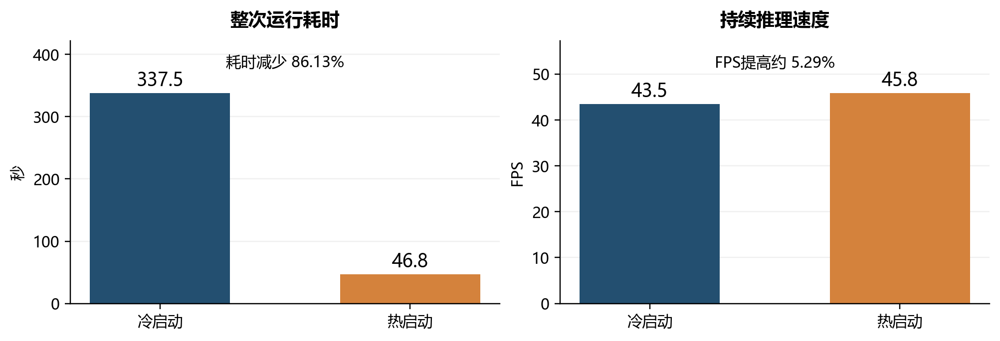
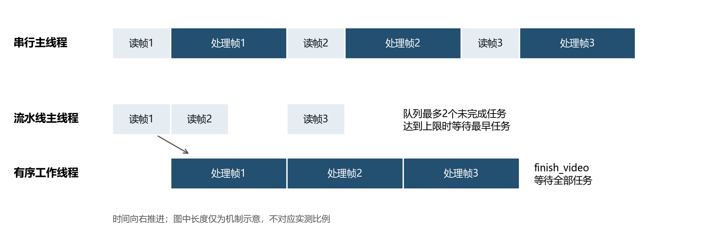
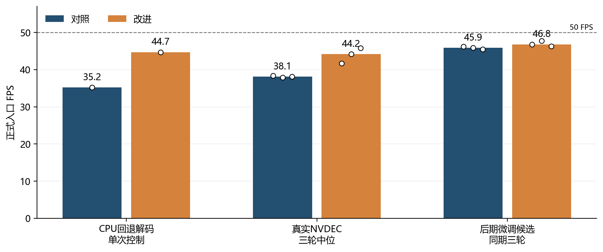

# 乒乓球多视角落点检测
# 技术与作业过程报告

2026 动感地带 AI＋高校创智计划 AI技术赛道

作者 张皓然　学号 320240944891

过程报告更新日期 2026年11月17日

**GitHub代码仓库** [asder20051228/ai-pingpong-multiview](https://github.com/asder20051228/ai-pingpong-multiview)

**Docker镜像与材料下载** [v2026.11.16 Release](https://github.com/asder20051228/ai-pingpong-multiview/releases/tag/v2026.11.16)

## 摘要

本作业从官方球定位模型和简单触台规则起步，先核查数据、训练与比较定位模型，再逐事件诊断球台门控、轨迹缺失、透视运动和数值边界问题，最后优化执行流程并封装Docker。报告同时记录初始结果、代码改动、失败对照、性能验证与可复现交付过程。

同一本地公开集口径下，初始参考规则精度分约45.23/75，最终冻结版本为71.3854/75，得到86个正确事件、1个误检和6个漏检。公开集参与过调优，因此这些结果表示开发过程的改进，不是官方隐藏测试成绩。[E01]、[E13]

速度提升来自不同层面：复用引擎缓存使一组完整运行从337.5秒降至46.8秒，主要减少准备时间；真正的解码与推理流水线在同卡、同算法的NVDEC对照中，将中位速度从38.1提升至44.2 FPS，约提高16.0%。最终冻结版后期三轮复测中位数为45.9 FPS；46.8 FPS的独立候选未替换交付版本。[E16]、[E17]

<!--widths:5.0,11.4-->
| 交付项目 | 当前结果 |
| --- | --- |
| 精度 | 宽松71.3854/75；严格70.3010/75 |
| 速度证据 | 单卡4090热启动中位45.9 FPS |
| 容器验证 | 4060 Laptop上17段视频自测通过 |
| 作品组成 | 代码、ONNX权重、完整镜像、报告与原始实验依据 |

阅读顺序：第1至8节说明如何完成算法与精度改进；第9至15节集中解释提速；第16至19节说明交付、复现和证据位置。

<!--PAGE-->
## 1 任务理解与实际工作流程

### 1.1 先明确要检测什么

输入是一段比赛视频，输出每次球接触球台时的帧号与图像坐标，而不是所有可见球的位置。帧号从0开始；坐标必须还原到原视频尺寸。0°、45°、90°分别评价后再汇总。本方案逐段检测，不进行多相机标定或三维三角化；模型的“三帧输入”指时间邻帧，也不是三个机位同时输入。

公开验证集有15段视频、2109帧、92个有效触台事件和12个干扰事件。有效事件按时间误差不超过1帧、距离不超过50像素进行一对一匹配。每个视角计算Precision、Recall与F1，精度分为25×(F1₀°＋F1₄₅°＋F1₉₀°)。不能把逐帧球定位命中率直接当作触台F1。[E23]

### 1.2 数据整理与监督信号

训练集有154段视频、23690帧，标注主要是球、球台、运动员和裁判的框，没有完整人工触台事件标签。首先统计分辨率、帧率、框尺寸和来源分组，检查坐标映射及重复来源。球台掩码由矩形框生成，实际学习的是球台区域，不能声称使用了精细桌面分割真值。

训练集并非全部都是1920×1080：119段为1280×720，21段为1266×720，14段为1920×1080。缩放和恢复坐标必须使用各视频真实宽高。训练邻帧也不能一概按固定帧号差解释成40毫秒。

### 1.3 项目完成顺序

<!--widths:3.0,13.4-->
| 阶段 | 实际完成的工作 |
| --- | --- |
| 10月13日前后 | 数据审计；训练三帧Tiny U-Net并与官方定位器比较 |
| 10月15日前后 | 规则基线、ResNet18球台训练对照、门控接入检查 |
| 10月18日 | 归一化与解码诊断；逐轮事件改进；4070/4090复测；流水线提速 |
| 11月15日 | 在官方基础镜像内组装工程并完成17段视频联合自测 |
| 11月16至17日 | GitHub公开交付；整理初始结果、迭代证据与完整过程报告 |

每轮采用“保存旧版—提出一个可解释的改动—轨迹回放筛查—原入口全量验证—逐事件核对—冻结保留”的顺序。阈值与策略对所有视频统一执行；视频编号只用于误差报告，不进入推理条件。

<!--PAGE-->
## 2 初始方案与第一次结果

### 2.1 官方参考规则提供了起点

最初保留官方ball.onnx，用球心纵坐标的局部极大值、下降/上升幅度和最小间隔判断触台。为了避免评分口径不同造成误判，将官方规则与改进规则放到同一个轨迹回放和本地评分器下比较。[E01]、[E02]

<!--widths:5.3,3.7,3.7,3.7-->
| 方案 | 严格精度分 /75 | 宽松精度分 /75 | 宽松宏平均F1 |
| --- | ---: | ---: | ---: |
| 初始参考规则 | 44.05 | 约45.23 | 0.6031 |
| 第一版调优规则 | 47.03 | 约47.92 | 0.6390 |

这组历史文件把部分F1先四舍五入，初始分数只能按记录精度引用。后续从原始计数计算的47.9269通常显示为47.93。官方文档给出的整体参考值与其分视角数字也不完全对应，因此本报告使用同一评分器的本地对照，不混用不同口径。

第一版把对称窗口从±1帧扩大到±2帧，把下落/反弹幅度从2.0/1.0像素放宽到0.5/0.5像素，将最小间隔从10帧改成7帧，并增加110像素的两帧平均速度限制和延迟非极大值抑制。它改善了部分浅反弹，但45°视角曾下降，说明全局阈值放宽不能解决所有机位问题。

### 2.2 自训定位模型没有超过官方模型

训练了479601参数的三帧Tiny U-Net，输入512×288，输出256×144热图；使用16537个训练样本、4100个验证样本，按来源分组，随机初始化。4070上物理batch为4，AdamW初始学习率3×10⁻⁴；最多50轮，patience为10。实际第15轮提前停止，第5轮验证损失最佳，约0.1406223。[E03]

<!--widths:7.4,4.5,4.5-->
| 相同4100帧原图坐标评价 | 10像素命中率 | 中位定位误差 |
| --- | ---: | ---: |
| 官方定位器取峰值 | 94.68% | 2.56像素 |
| 自训定位器取峰值 | 74.12% | 4.04像素 |

训练时把连续RGB帧拼成9通道，用高斯中心热图监督；三个邻帧共享翻转和亮度变化，避免破坏时序对应。采用正区域加权Gaussian BCE，无球框帧按未知样本跳过，最佳检查点按验证损失选择，不按比赛公开分数选择。

因此保留官方定位权重，改进事件判定和区域约束。10月15日在Windows直接尝试正式入口时还曾因缺少TensorRT在prepare阶段失败；该次没有有效FPS或精度结果，不能用“0 FPS”作为提速基线。

<!--PAGE-->
## 3 球台模型训练与接入失败的修复

### 3.1 用同配置对照决定是否采用预训练

球台模型使用ResNet18编码器，输入320×192，输出区域预测。两组保持数据划分、增强、优化器和30轮训练预算一致，仅改变初始化；batch为24，主学习率3×10⁻⁴，骨干学习率6×10⁻⁵，随机种子为0。训练样本3029、验证样本767，采用来源分组。[E04]

<!--widths:5.0,3.0,4.2,4.2-->
| 初始化 | 最佳轮次 | 验证box IoU | IoU≥0.5比例 |
| --- | ---: | ---: | ---: |
| 随机初始化 | 18 | 0.5776 | 59.71% |
| ResNet18预训练 | 16 | 0.8181 | 97.65% |

据此选择预训练方案，再用固定40像素边界扩展进行事件诊断。离线结果约52.13/75，但第一次接入ONNX后，门控开启只有47.491/75，低于关闭门控的47.927/75。不能因为球台IoU提高，就直接宣称最终触台效果提高。[E05]

### 3.2 对齐模型输入发现重复归一化

检查点导出的TableSegNet已在计算图内执行ImageNet归一化，推理封装又在图外归一化一次，造成训练与部署输入不一致。修复只删除图外重复处理，权重和40像素门控保持不变。多样本比较PyTorch与ONNX输出，确认正确路径的最大绝对误差约10⁻⁶，区域掩码一致，随后再跑正式生命周期。

<!--widths:6.0,5.2,5.2-->
| ORT CUDA与OpenCV路径 | 严格 /75 | 宽松 /75 |
| --- | ---: | ---: |
| 关闭球台门控 | 47.0314 | 47.9269 |
| 修复后开启门控 | 51.0939 | 52.1361 |
| 同条件增益 | +4.0625 | +4.2092 |

修复后15段视频中，门控保留59个有效命中，误检从26降至14；它删除的是区域不符的候选，没有减少这组已有命中。该结论只针对本次公开集，框预测异常时仍应保留候选，避免用不可靠区域误删真触台。

这一阶段的关键工作不是继续扩大模型，而是逐项核对输入范围、归一化位置、输出坐标、帧号及门控实际调用位置。

<!--PAGE-->
## 4 从兼容推理转入正式入口

### 4.1 精度下降需要拆开排查

切换到比赛锁定的TensorRT和官方GPU解码后，门控版本从52.1361降为50.5027/75。此时推理精度和解码路径同时改变，因此追加交叉实验，而不是把差异直接归因于FP16。[E06]

<!--widths:10.7,5.7-->
| 相同4070与同一公开集 | 宽松精度分 /75 |
| --- | ---: |
| TensorRT FP16与OpenCV | 52.1361 |
| TensorRT FP16与官方GPU解码 | 50.5027 |
| 严格FP32与OpenCV | 52.1361 |
| 严格FP32与官方GPU解码 | 51.2170 |
| ORT CUDA与官方GPU解码 | 51.2170 |

两处关键帧实验中，原始YUV内容一致，但RGB颜色转换路径有约0.89/255的平均通道差。微小输入变化让置信度跨过离散门槛：一个真实候选的参考帧置信度由0.750000降至0.731934；另一个噪声候选由0.749940升到0.750977，并在NMS竞争中压掉真触点。

### 4.2 将触点门槛与参考帧门槛分开

将顶点置信度设为至少0.80、两侧参考点设为至少0.70，保持ONNX、球台门控、官方解码与框架不变。正式入口恢复到52.1361/75，两次预测逐字节一致。但逐GT检查发现“总分恢复”不等于“原有命中集合完全恢复”：一处旧命中丢失，同时新增另一处命中。

随后针对弱顶点加入邻帧确认：中心达到0.75，左右相邻点均达到0.80，且实际下落/反弹均达到0.5像素，才进入原有幅度、跳变、NMS与球台检查。这使TP由59增至60，FP保持14，精度分从52.1361增至52.6154。[E07]

失败对照同样保留：直接把所有顶点门槛降到0.75只得到51.4948。最终采用受约束的补救分支，而不是全面降低置信度。之后每轮都检查“新增哪些GT、丢失哪些GT、哪些坐标变化”，避免只看总分掩盖回退。

<!--PAGE-->
## 5 从60个命中提升至75个命中

### 5.1 用速度变化补充图像纵坐标极值

透视下，触台后球心仍可能继续向图像下方移动，因此单靠局部y极大值会漏检。例v000019第67帧附近，y从587.48、599.45变到605.70，没有传统反弹顶点。新增五帧高置信度的速度突变支路，同时约束水平运动、单帧位移和球台区域；外围缺帧时允许更短窗口补救。[E08]

单帧跳变也必须单独检查：两帧平均速度可能掩盖一次错误位置跳转，因此增加220像素/帧的相邻位移上限。旧峰值规则保留，新增分支经过同一去重逻辑。

<!--widths:8.4,4.0,4.0-->
| 对照 | 宽松精度分 /75 | 丢失旧命中 |
| --- | ---: | ---: |
| 旧版 | 52.6154 | 0 |
| 仅五帧速度突变 | 60.4603 | 0 |
| 最终加跳变检查与缺帧短窗口 | 61.5393 | 0 |
| 更宽松的外围置信度方案 | 62.9926 | 1 |

最终保留全部60个旧命中，新增12个，得到72 TP、11 FP、20 FN。虽然放宽版本分数更高，但会丢失已有事件，未采用；这说明版本选择还包含逐事件回归约束。

### 5.2 调整候选优先级和过滤顺序

下一轮对单个外围弱点采用低优先级补救：五点窗口中，中心及两侧邻点均须达到0.80，两个外围点均须达到0.70且至少一个达到0.80，即至少四个强点。它可以补充事件，但不替换已有强候选。停滞与水平反向检查放在NMS选定候选后执行，以免提前删除候选让另一个假点顶替。[E09]

同时取消球台框40像素外扩，删除框外误检。这一组合将72/11/20改为75/6/17，分数61.5393→65.2333。全部72个旧命中的帧号和坐标保持不变。已验证的真触点距框边缘最小仅约1.64像素，因此该收紧策略对未知场景的框误差仍需独立检验。

提前门控、改变位置NMS和提前水平反向过滤都出现过丢失旧GT的情况，未进入最终方案。改进过程同时涉及候选生成与候选竞争顺序。

<!--PAGE-->
## 6 缺帧恢复与高速触台时刻细化

### 6.1 保留主分支再恢复未覆盖事件

新增contact_recovery.py，在视频结束时扫描已经缓存的轨迹；最多补齐连续2帧缺失，要求两端置信度至少0.75、运动连续、位移合理。插值只用于补足判定上下文，此阶段输出位置仍来自真实观测球心，不直接把插值点当作真实检测。[E10]

补救分支结合时间和位置去重：与已有事件相距小于7帧且不超过100像素时不新增。原来单按时间抑制，会把相隔6帧但空间相距约200像素的两次事件混为一次。最终新增6个命中，得到81/6/11，分数65.2333→67.9375，旧75个命中原样保留。

直接插值也会恢复假轨迹。无约束补最多2帧时出现9个FP；加入水平连续性和端点置信度后回到6个FP，因此“补点更多”并不等于更准确。

### 6.2 时间容差内仍可能出现坐标超差

v000106中，球横向每帧移动约100像素。旧预测在133帧，虽然与134帧GT相差1帧，但图像距离约66.06像素，超过50像素阈值。新增contact_refinement.py，对七帧连续轨迹拟合允许一次速度突变的分段二次模型：[E11]

```text
y(t) = a + b t + c t² + d max(t − τ, 0)
τ在[-0.9, 0.9]内按0.025帧步长搜索
```

拟合时刻约133.525帧，输出134帧并细化位置后，与GT距离约24.2像素。这不是把所有预测统一平移一帧，而是对可靠、高速局部轨迹进行时间与坐标联合估计。

拟合要求七点均达到0.75、至少六点达到0.80，并检查残差、水平连续性、速度突变、球台范围和去重。对已有输出采取保守修正阈值，避免无收益地改动大量坐标。

结合受约束的跨缺帧水平反向过滤后，TP增至83，FP降至4，FN降至9，分数升至69.3854。只按水平反向删除曾误伤真实反弹；加入“水平变化大于竖直变化”才避免该回退。

<!--PAGE-->
## 7 多通道补观测与颜色约束

### 7.1 复用已有模型输出而不增加模型调用

三帧球模型有多个时间通道。中间通道缺失球点时，可将相邻窗口的其他通道对齐回同一源帧，作为候选补观测。已有可靠中间通道球点保持原值；连续性只参考原始强观测，不能让新补点互相证明自身正确。[E12]

<!--widths:8.4,4.0,4.0-->
| 方案 | TP / FP / FN | 宽松分 /75 |
| --- | --- | ---: |
| 冻结83命中版本 | 83 / 4 / 9 | 69.3854 |
| 不加连续性约束 | 85 / 6 / 7 | 69.5036 |
| 加连续性约束 | 84 / 5 / 8 | 69.4460 |
| 仅使用未来上下文补点 | 85 / 4 / 7 | 70.0954 |

某些通道在特定时间段虽通过位置连续性检查，仍引入触台误检，因此最终仅使用包含后续上下文的补点支路。新方案中位35.5 FPS，对照35.7 FPS；它主要改善精度，没有宣称增加了速度。

### 7.2 从85个命中到86个命中

在85命中版本上，对恢复点增加受约束三帧反弹检查，并过滤浅峰及横向加速占主导的事件，得到86/2/6、71.0609/75。再加入场景内球台主色支持，去除落入粗矩形框角部的一次台外弹跳，得到86/1/6、71.3854/75。[E13]

颜色模板由预测球台框中央估计，不固定某种球台颜色。只有模板可信、连续三帧的局部主色支持均不足时才否决；模板不确定就保留。其依据是图像邻域和运动，不是视频编号特例。

<!--widths:7.0,4.7,4.7-->
| 4070同期方案 | 精度分 /75 | 三次FPS与中位数 |
| --- | ---: | --- |
| 轨迹规则组合 | 71.0609 | 35.9、35.5、35.9；35.9 |
| 加颜色支持 | 71.3854 | 33.3、33.7、33.3；33.3 |

颜色约束提高精度但增加CPU图像处理。按当时4070速度折算，总分反而约从89.15降至88.21，因此保留两个候选，到目标硬件重新验证。最高精度与最高综合分不能自动视为同一方案。

<!--PAGE-->
## 8 完整的精度演进与版本选择

下表按开发顺序汇总。初始两行是历史轨迹回放，后续主要为原比赛入口的全视频验证；前半部分在4070进行，最后一行另含4090适配。它是开发记录，不是同时完成的严格端到端消融。

<!--widths:8.2,4.1,4.1-->
| 阶段与主要改变 | TP / FP / FN | 宽松精度分 /75 |
| --- | --- | ---: |
| 官方参考规则同口径回放 | 原摘要未列总计 | 约45.23 |
| 初始窗口与幅度规则调整 | 59 / 26 / 33 | 约47.93 |
| 球台归一化修复及门控 | 59 / 14 / 33 | 52.1361 |
| 邻帧确认弱顶点补救 | 60 / 14 / 32 | 52.6154 |
| 速度突变与缺帧短窗口 | 72 / 11 / 20 | 61.5393 |
| 低优先级补救与末端过滤 | 75 / 6 / 17 | 65.2333 |
| 受约束轨迹恢复 | 81 / 6 / 11 | 67.9375 |
| 连续时刻拟合与反向过滤 | 83 / 4 / 9 | 69.3854 |
| 未来上下文多通道补点 | 85 / 4 / 7 | 70.0954 |
| 轨迹组合与颜色支持 | 86 / 1 / 6 | 71.3854 |
| 4090边界补救及按需FP32 | 86 / 1 / 6 | 71.3854 |

初始参考规则到最终版本约增加26.16个精度分。比较时一直保留严格口径对照，最终严格分为70.3010/75。最终90行预测中，86行匹配有效GT，1行是宽松口径的FP，另3行被宽松口径按干扰事件忽略；不能用90−86直接断言宽松FP为4。

### 8.1 为什么保留逐事件证据

总分提高可能同时隐藏旧事件丢失。中期迭代采用逐GT回归检查，优先保留已有命中，并记录帧号和坐标是否变化。跨硬件迁移时不能假定原预测仍相同，因此重新检查同一GT身份和误检集合，边界问题通过独立对照处理。[E15]

### 8.2 为什么没有继续无限调阈值

所有15段公开视频已经参与开发。后期剩余误差涉及连续缺球、遮挡、模糊、二维投影不形成明显反弹等情况。继续围绕这些视频增加例外条件可能只提高开发分。本报告保留实际冻结版本，独立速度候选和更宽松事件规则单独保存。

<!--PAGE-->
## 9 速度提升首先要分清计时范围

### 9.1 整次运行与持续推理是两个指标

正式FPS使用2109除以infer_sec，包含解码、参赛算法、视频收尾和输出；prepare_sec另列。首次从ONNX构建TensorRT引擎需要较长准备时间，复用缓存后准备时间大幅缩短，但不能把这个倍数写成持续推理FPS的倍数。

<!--widths:6.4,5.0,5.0-->
| 同一4090打包版本 | 冷启动 | 热启动 |
| --- | ---: | ---: |
| prepare_sec | 289.0秒 | 0.7秒 |
| 其中引擎构建 | 287.4秒 | 0秒 |
| infer_sec | 48.5秒 | 46.0秒 |
| total_sec | 337.5秒 | 46.8秒 |
| 正式infer_fps | 43.5 | 45.8 |



图1 同一打包版本的实测对照。整次运行耗时比为337.5/46.8≈7.21，耗时减少86.13%；持续FPS只提高约5.29%。日志各项独立四舍五入，分项之和与total可差0.1秒。[E16]

### 9.2 缓存具体怎样使用

官方core/trt.py已实现缓存，不是本项目新增的算法创新。缓存按TensorRT版本、GPU型号、ONNX内容哈希区分；不匹配或反序列化失败时重建。严格FP32另有独立缓存名。开发复测保留有效缓存，正式镜像仅携带ONNX，在目标机器建立自己的引擎。[E21]

冷、热两次均为86/1/6，但预测文件SHA256不同，不能声称重新构建引擎后坐标逐字节不变。缓存比较用于解释准备时间；算法保持性还需看同缓存、同输入的独立对照。

<!--PAGE-->
## 10 先测量瓶颈再决定优化位置

### 10.1 不是所有时间都花在神经网络计算

4070上冻结85版本的一次全量剖析中，2109帧总推理59.1秒，球模型与球台模型的TensorRT执行及等待合计6.34865秒，只占约10.7%。数据上传、分配和下载还需额外时间；图像缩放、颜色统计、轨迹规则、解码和同步也在端到端路径中。[E13]

<!--widths:7.0,4.7,4.7-->
| 模型剖析项目 | 球模型 | 球台模型 |
| --- | ---: | ---: |
| 上传及分配 | 1.3732秒 | 0.5150秒 |
| 执行及等待 | 5.7479秒 | 0.6008秒 |
| 下载 | 0.8105秒 | 0.1306秒 |
| 调用次数 | 2109 | 2109 |

如果其余耗时固定，只把6.34865秒的执行部分加速2倍，总耗时仍约55.93秒，对应约37.7 FPS，而不是速度翻倍。这是按该次剖析推导的条件估算，不是新实测，也不是GPU硬件极限。

### 10.2 更换4090只带来有限的整体变化

早期跨机器复测中，轨迹版从4070中位35.9变为4090的38.4 FPS；颜色版从33.3变为36.5 FPS。两台机器的CPU、驱动和FFmpeg不同，且后续发现4090解码曾静默回退，因此这不是纯GPU型号消融。[E14]、[E15]

4090早期热启动轨迹版的一轮记录为：解码17.41秒，算法36.49秒，总infer 55.3秒。串行主循环在算法执行时不能及时继续读取下一帧。分析重点因此转向阶段重叠和数据读取，而不是单纯更换更强GPU或再改检测阈值。

### 10.3 测量的方法

每轮先冻结模型、阈值、输入和引擎缓存，再从run_status读取prepare、infer与total；结合逐视频decode_sec、solution_sec、GPU利用率与诊断profile定位瓶颈。异步执行后不同阶段可重叠，不能再把各线程统计简单相加解释为真实总耗时。

<!--PAGE-->
## 11 发现并修复NVDEC静默回退

### 11.1 写了GPU解码参数不代表硬解码成功

4090最初用的是--decoder gpu，但FFmpeg出现cuvidGetDecoderCaps的CUDA_ERROR_NO_DEVICE后实际回退到CPU。因FFmpeg最终退出码仍为0，正式入口没有展示该段stderr，单靠参数和cpu_fallback计数不足以证明硬解码可用。[E15]

直接探测发现CUDA上下文能创建，GPU计算正常，而视频解码能力查询返回100；4070相同查询则成功。由此把“TensorRT计算可用”和“NVDEC视频解码可用”分开诊断。早期4090报告的GPU解码描述已由后续调查纠正，不能继续原样作为硬解码证据。

### 11.2 进程级兼容处理与验证

该服务器驱动580.105.08的设备枚举结果包含8张GPU，而容器只分配了一张。进程级兼容处理过滤不可见设备后，同一查询返回0，supported=1。处理作用于实验启动进程，没有更换系统驱动、替换官方代码或重启服务器。[E16]

验证分三步完成：15段视频强制h264_cuvid解码全部成功；检查stderr与实际NVDEC利用率；比较正式GPU解码的RGB像素与经NV12转换的CPU结果。强制解码检查比“命令带gpu参数”更有证明力。

### 11.3 修复硬解码仍不是全部提速

<!--widths:8.2,4.1,4.1-->
| 同一冻结算法的串行路径 | 全量FPS | TP / FP / FN |
| --- | ---: | --- |
| 实际CPU回退控制 | 35.2 | 86 / 1 / 6 |
| 真NVDEC三轮中位 | 38.1 | 86 / 1 / 6 |

35.2与38.1只是该轮单次控制对三轮中位的观察，不能等同多轮严格配对的净硬解码增益。更有力的持续提速证据来自下一阶段固定解码路径后比较串行与流水线。

兼容库仅保留在历史服务器实验资料中，没有装入正式参赛participant或Docker镜像。正常比赛环境直接使用官方解码；不能把针对该实例的兼容处理写成普遍必需步骤，也没有宣称组委会许可任意修改驱动调用。

<!--PAGE-->
## 12 真正改变执行顺序的有界流水线

### 12.1 从逐帧等待改为阶段重叠

原执行顺序是读取一帧，完成球模型、球台模型和轨迹处理，再读取下一帧。改造后，主线程保持官方读取逻辑；参赛者模块把该帧交给单个有序工作线程，主线程可继续读取后续帧。解码/读取与算法执行因此发生重叠。[E20]



图2 执行依赖示意，不表示实测耗时比例。工作线程按帧顺序处理，最多保留2个未完成任务；结束视频时等待全部任务。

### 12.2 为什么不能随意多开线程

ContactTracker、三帧输入缓冲、NMS和颜色模板都依赖顺序。多线程并发处理不同帧可能改变状态，因此帧级工作线程数固定为1。队列上限2提供背压，防止读取无限超前；1920×1080 RGB的两份副本约12.4 MB，但这不包括模型、当前解码帧与其它缓存。

```python
# 与交付实现一致的主要流程，省略异常清理
if len(pending) >= 2:
    outputs += pending.popleft().result() or []
pending.append(worker.submit(core.process_frame,
                             rgb.copy(), dict(meta)))
# finish_video内排空pending，再等待core.finish_video
```

复制rgb与meta，防止解码缓冲复用后工作线程读到下一帧；reset前先排空上一视频；Future.result传播异常；finish_video等待全部计算完成。因此没有把计算移到计时区间外，也没有跳帧或少处理视频。所有变化位于参赛者代码区。

<!--PAGE-->
## 13 同条件对照确认持续速度提升

所有下列流水线控制都使用同一单卡4090、15段视频、2109帧和86命中冻结算法；不改变模型、图像尺寸、阈值或球台逐帧调用。每轮从正式入口读取infer_fps，并核对预测及输出格式。[E16]、[E17]

<!--widths:6.0,4.1,4.1,2.2-->
| 对照范围 | 改造前FPS | 改造后FPS | 变化 |
| --- | --- | --- | ---: |
| CPU回退解码，单次控制 | 35.2 | 44.7 | +27.0% |
| 真NVDEC，三轮中位 | 38.1 | 44.2 | +16.0% |
| 后期同期三轮候选对照 | 45.9 | 46.8 | +1.96% |



图3 圆点是各次实测，柱表示该组代表值。前两组检验流水线，第三组检验后期微调；不能把三组增益相乘，视作一条严格连续消融链。

NVDEC串行三轮为38.4、37.9、38.1 FPS，流水线为41.7、44.2、45.8 FPS。分数和86个GT命中均保持；该组预测文件SHA256一致。CPU回退控制从59.9降至47.1秒，同样说明阶段重叠具有作用，但单次控制不足以估计稳定方差。

打包后的热启动一次为45.8 FPS；在后续相同环境的新一轮复测中，冻结版为46.2、45.9、45.5 FPS，中位45.9。它比早期44.2更高，但轮次、系统状态和整理阶段不同，不能把差额全部归因于某个未隔离的代码改动。

按公开速度公式1＋24×(FPS−1)/49计算，45.9 FPS对应约22.99/25，加71.3854精度分约为94.38/100。这仍是本机单卡公开集估算，不是指定双卡环境或官方隐藏榜单成绩。

<!--PAGE-->
## 14 速度与数值精度之间的取舍

### 14.1 只复核置信度边界帧

迁移到4090时，两个原有命中因输入颜色转换和阈值跨越丢失，变成84/2/8。单纯全程改FP32没有找回全部事件；需要结合置信度边界与浅反弹补救。全程严格FP32与按需FP32都能达到86/1/6后，再比较执行代价。[E15]

交付代码先用FP16推理；当中间通道峰值在0.795至0.805内时，用禁用FP16和TF32的严格FP32球模型重新检查。球台模型仍为FP16。该轮14/2109帧触发，约0.664%；这个比例是本次观测，不是所有硬件和输入上的固定比例。

```python
y = fp16_infer(x)
confidence = float(y[0, 1].max())
if abs(confidence - 0.80) <= 0.005:
    y = strict_fp32_model.infer(x)
```

全程严格FP32补救控制一次为35.5 FPS，按需方案一次为36.9 FPS，二者同为86/1/6；这个单次差异不能直接写成稳定加速比。按需版本后续三轮为36.5、34.5、36.7 FPS，中位36.5；旧84命中版中位36.7。其主要价值是以接近原速度恢复精度，而非解释全部流水线收益。

### 14.2 自动识别设备与最多两卡执行

可见0卡时明确报错；1卡时两模型均使用GPU0；可见至少2卡时最多使用GPU0和GPU1。双卡路径将球模型及精度复核放在GPU0，球台模型放在GPU1，两分支结束后仍按同一帧顺序更新轨迹。

本地接口检查覆盖0/1/2/8卡的选择逻辑、队列顺序、缓冲所有权、重置和异常传播，但实际测速只有单卡。模拟设备数量的检查不等于真实双卡性能测试。单卡同GPU分支并发只作为独立候选验证，不是交付入口的默认新替换。

同样不能把4070的33.3与4090最终45.9直接解释为纯代码加速37.8%；它们包含硬件、解码、方案整理和运行阶段的共同变化。

<!--PAGE-->
## 15 继续追求50 FPS时做过什么

### 15.1 25轮完整实验没有稳定达到50 FPS

在冻结86命中的基础上，进一步比较OpenCV和PyTorch线程数、等价归一化、同卡分支并发、帧缓冲、队列深度、CPU亲和性、提前预处理和管道大小。25轮完整模型评测均保持86/1/6，预测SHA256一致；这些微调不允许通过改阈值、缩小输入或减少球台调用获得表面速度。[E17]

<!--widths:9.6,3.4,3.4-->
| 方案 | 单次FPS | 处理结果 |
| --- | ---: | --- |
| OpenCV设1线程 | 46.5 | 继续组合对照 |
| 1线程加同卡分支并发 | 47.5 | 做三轮重复 |
| OpenCV设4或8线程 | 45.7 / 45.4 | 无明显优势 |
| 等价归一化 | 47.1 | 作为候选留存 |
| CPU亲和性16或8核 | 43.4 / 43.7 | 未采用 |
| 队列放宽到8 | 47.1 | 不替换有界默认方案 |
| 提前预处理1/2/4线程 | 46.5 / 46.0 / 47.1 | 没有明确突破 |
| 候选三轮中位 | 46.8 | 独立留存，未替换正式版 |

表中的单次高值不能与另一组最低值拼出夸大的提升。同期冻结版中位45.9，候选中位46.8，仅增加1.96%；47.7是候选单轮最高，不是稳定速度保证。

### 15.2 为什么继续堆线程收益很小

去掉模型、只读取官方GPU解码输出的两次全量诊断为47.1和45.2 FPS，已接近完整模型结果。它说明当时解码与读取路径是主要限制之一，不证明4090存在固定47 FPS硬件上限。扩大本进程管道到1 MiB后，纯解码44.6 FPS，也没有收益。

pre2记录中主线程读帧累计38.71秒，process_frame与finish_video累计3.30秒；由于异步重叠，不能把后者叫作全部模型GPU时间。worker.pstats只覆盖首段125帧，也不能冒充2109帧完整剖析。

因此冻结已有稳定版本，把未突破瓶颈的尝试如实保留；下一步应在比赛同款环境研究解码、CPU资源和RGB传输，而不是继续用精度规则换速度。

<!--PAGE-->
## 16 最终方案怎样封装成可提交作品

### 16.1 冻结算法再组装官方工程

交付入口为participant.solution:Solution，实际导入有界流水线；底层保留球定位、球台区域、事件恢复、时间细化、颜色支持和按需FP32。球输入为1×9×288×512，球台输入为1×3×192×320；输出恢复到原视频坐标。[E20]

以sport-base:v1为基础，保持Ubuntu 22.04、Python 3.10、PyTorch 2.1.2+cu118、TensorRT 8.6等基础环境。工程放在/participant，默认入口为/participant/run_all.sh；篮球保留官方参考实现，避免只完成单项却破坏联合入口。

组装时核对42个官方非乒乓球代码区文件，并检查冻结模块和权重哈希；未通过修改core、run.py或validate.py改变评测。Git中的participant目录保持原始字节，避免Windows换行转换破坏官方完整性校验。

### 16.2 用实际容器验证闭环

<!--widths:7.0,9.4-->
| 2026年11月15日本机验证 | 结果 |
| --- | --- |
| 硬件与运行方式 | RTX 4060 Laptop GPU，Docker Desktop/WSL2 |
| 网络条件 | 容器禁网运行 |
| 两项环境及方案检查 | 全部通过 |
| 联合视频处理 | 乒乓球15/15；篮球2/2 |
| 输出错误与CPU解码回退 | 均为0 |
| 乒乓球本机持续速度 | 39.1 FPS |
| 乒乓球精度 | 宽松71.3854；严格70.3010 |

当前容器与历史4090输出的90个视频/帧号键一致；坐标最大差约1.12像素，平均约0.105像素，说明数值末位有变化，但本次事件计数和分数一致。4060速度仅用于交付验证，不能直接当作2×4090平台成绩。[E18]

完整镜像保留官方基础层，包含两项任务及公开验证视频，导出压缩归档约14.5 GB。归档校验、压缩CRC和33个镜像层完整性检查通过；GitHub Release以14个分卷保存，下载工具合并后再核对完整SHA256。[E22]

<!--PAGE-->
## 17 怎样复现这份作业的结果

### 17.1 下载已经验证的完整镜像

```bash
git clone https://github.com/asder20051228/ai-pingpong-multiview.git
cd ai-pingpong-multiview
python tools/download_image.py --load
```

要求Python 3.9以上、curl和可使用NVIDIA GPU的Docker。工具支持续传、逐卷校验、按序合并与整体校验；下载合并至少预留30 GB空间，另为Docker加载留出空间。无需逐卷解压。加载标签为pingpang-submit:20261115。

### 17.2 禁网运行公开集自检并读取实际日志

```bash
mkdir -p "$PWD/test-output"
docker run --rm --gpus all --network none \
  --mount "type=bind,source=$PWD/test-output,target=/participant/output" \
  --entrypoint /selftest.sh pingpang-submit:20261115
python tools/score_public.py \
  test-output/pingpang/predictions.jsonl --output local-scores.json
```

以上为Bash写法；PowerShell可写成单行或使用反引号续行。读取输出中的run_status.json，分别记录prepare_sec、engine_build_sec、infer_sec和total_sec。

自检脚本会先运行check_solution并复制缓存，因此其中联合入口可能已经热启动。冷、热对照应按[README运行说明](../README.md)直接执行镜像默认run_all.sh入口：先用download_data.py取得输入，首次使用新的输出目录，随后复用同一输出目录内的兼容引擎，重复至少三轮。每轮保存状态与预测哈希，确认built/cached状态；不要让多个GPU实验互相抢占后再比较速度。

### 17.3 从代码构建及追溯训练

```bash
python tools/download_data.py
docker load -i /path/to/sport-base_v1.tar
docker build --network none --pull=false -t pingpang-submit:20261115 .
```

源码构建需取得组委会原始基础镜像。重新训练还需组委会训练视频和框标注；Release中的17段验证视频不能代替训练集，也不能提供新的独立测试。训练配置、原始轮次指标和模型选择依据列在证据索引中；交付复现优先使用已冻结ONNX，不把重新训练的随机结果冒充原实验。

完整归档SHA256：

```text
f6fd04893d10c5a8394597ac3e2acf7de01d2738ea6909eb06b3102b801cf5aa
```

<!--PAGE-->
## 18 这份作业中的有效经验与限制

### 18.1 有效改进来自可验证的问题定位

第一次自训球模型没有超过官方模型，因此把精力转到事件层；球台模型离线改善但接入失败，最终定位为重复归一化；分数相同却丢失旧事件，促使增加逐GT回归检查；更强GPU没有带来预期增益，促使测量解码和CPU路径。这些转折决定了后续工作，而不是预先假定某种模型一定更好。

<!--widths:7.2,9.2-->
| 尝试或判断 | 实验结果与最终选择 |
| --- | --- |
| 全局放宽阈值 | 可能提高总分但丢失旧命中，改为受约束低优先级补救 |
| 提前删除竞争候选 | 会暴露相邻假候选，改为末端检查或保守补充 |
| 直接插值缺失轨迹 | 新增误检，增加端点置信度、连续性和观测点约束 |
| 全程严格FP32 | 有额外代价且不能解决所有输入差异，采用边界复核 |
| 仅更换更强GPU | 解码、预处理和同步仍占时间，转向流水线 |
| 增大线程或管道 | 没有稳定突破50 FPS，保留冻结交付版本 |

### 18.2 对结果应作怎样的结论

最终公开集仍有6个漏检和1个宽松口径误检。0°视角为18/1/3，45°为37/0/1，90°为31/0/2。连续观测缺失、模糊和透视下不明显的运动转折仍未完全解决；颜色启发式对未知球台颜色、反光和遮挡也可能失效。

数据审计没有找到额外、已人工标注且未参与开发的触台测试集。26段球台模型验证视频参与过选模型，154段训练视频已有轨迹和算法候选使用记录；重新切分或改名不产生独立测试。因此本报告不把公开分数上涨解释为已证明泛化提升。[E19]

可确认的性能结论是：引擎缓存减少启动成本，有序流水线在同条件对照中提高持续吞吐，后期线程微调收益有限。真实双4090性能和官方隐藏成绩仍未实测。项目完成了数据处理、训练对照、工程诊断、受控迭代、性能验证及可下载交付的完整闭环。

<!--PAGE-->
## 19 证据索引与材料位置

所有定量结论可回到下列记录。新增历史证据集中在evidence/process_history，index.json记录73个原始文件的SHA256及提速公式结果；同目录保留REPORT、JSON、控制实验和运行状态，不依靠重新口述实验数值。

<!--widths:1.6,14.8-->
| 编号 | 可点击的证据与核对内容 |
| --- | --- |
| E01 | [初始同评分器对照](../evidence/process_history/same_scorer_comparison.json)　参考规则与初版规则 |
| E02 | [初始事件规则记录](../evidence/process_history/event_rule_notes.md)　窗口与幅度调整 |
| E03 | [训练与定位比较](../evidence/progress_4070_20261015.md)　轮次、早停和定位指标 |
| E04 | [球台训练对照](../evidence/table_detector/pretrain_ablation_20261015/)　配置与逐轮指标 |
| E05 | [归一化修复](../evidence/process_history/norm_fix_20261018/report.json)　门控与输出一致性 |
| E06 | [精度与解码排查](../evidence/process_history/precision_decode_20261018/REPORT.md)　交叉对照 |
| E07 | [邻帧确认补救](../evidence/process_history/temporal_rescue_20261018/REPORT.md)　59到60个命中 |
| E08 | [速度突变分支](../evidence/process_history/residual_20261018/REPORT.md)　60到72个命中 |
| E09 | [候选竞争与过滤](../evidence/process_history/residual72_20261018/REPORT.md)　72到75个命中 |
| E10 | [缺帧恢复](../evidence/process_history/residual75_20261018/REPORT.md)　75到81个命中 |
| E11 | [连续时刻细化](../evidence/process_history/residual81_20261018/REPORT.md)　81到83个命中 |
| E12 | [多通道补观测](../evidence/process_history/multichannel_20261018/REPORT.md)　83到85个命中 |
| E13 | [最终颜色与轨迹方案](../evidence/process_history/residual85_20261018/REPORT.md)　精度与模型剖析 |
| E14 | [早期4090复测](../evidence/process_history/benchmark4090_20261018/REPORT.md)　解码结论以后续排查为准 |
| E15 | [4090边界与解码诊断](../evidence/process_history/precision_rescue_4090_20261018/REPORT.md)　14帧复核与静默回退 |
| E16 | [NVDEC与流水线](../evidence/process_history/nvdec_parallel_20261018/REPORT.md)　冷暖缓存及三轮对照 |
| E17 | [50 FPS优化实验](../evidence/process_history/speed50_20261018/artifacts/REPORT.md)　25轮结果与候选 |
| E18 | [实际容器验证](../validation/container_validation_summary.json)　17段视频与本机结果 |
| E19 | [独立数据审计](../evidence/holdout_audit_20261018/REPORT.md)　数据使用范围和限制 |
| E20 | [有序流水线代码](../participant/pingpang/participant/parallel_solution.py)　队列、设备与收尾 |
| E21 | [官方引擎缓存代码](../participant/pingpang/core/trt.py)　缓存键与重建逻辑 |
| E22 | [完整镜像清单](../release/docker-image.json)　分卷、归档哈希及镜像ID |
| E23 | [数据审计](../evidence/data_audit.json)　视频、标注和尺寸统计 |

文中代码片段用于解释实现；运行时以仓库中的冻结参赛代码为准。图1及图3由已保存的JSON数值生成，图2是执行依赖示意。初始回放、不同硬件、冷启动、热启动和独立候选均已分开标识。

[E01]: https://github.com/asder20051228/ai-pingpong-multiview/blob/main/evidence/process_history/same_scorer_comparison.json
[E02]: https://github.com/asder20051228/ai-pingpong-multiview/blob/main/evidence/process_history/event_rule_notes.md
[E03]: https://github.com/asder20051228/ai-pingpong-multiview/blob/main/evidence/progress_4070_20261015.md
[E04]: https://github.com/asder20051228/ai-pingpong-multiview/tree/main/evidence/table_detector/pretrain_ablation_20261015/
[E05]: https://github.com/asder20051228/ai-pingpong-multiview/blob/main/evidence/process_history/norm_fix_20261018/report.json
[E06]: https://github.com/asder20051228/ai-pingpong-multiview/blob/main/evidence/process_history/precision_decode_20261018/REPORT.md
[E07]: https://github.com/asder20051228/ai-pingpong-multiview/blob/main/evidence/process_history/temporal_rescue_20261018/REPORT.md
[E08]: https://github.com/asder20051228/ai-pingpong-multiview/blob/main/evidence/process_history/residual_20261018/REPORT.md
[E09]: https://github.com/asder20051228/ai-pingpong-multiview/blob/main/evidence/process_history/residual72_20261018/REPORT.md
[E10]: https://github.com/asder20051228/ai-pingpong-multiview/blob/main/evidence/process_history/residual75_20261018/REPORT.md
[E11]: https://github.com/asder20051228/ai-pingpong-multiview/blob/main/evidence/process_history/residual81_20261018/REPORT.md
[E12]: https://github.com/asder20051228/ai-pingpong-multiview/blob/main/evidence/process_history/multichannel_20261018/REPORT.md
[E13]: https://github.com/asder20051228/ai-pingpong-multiview/blob/main/evidence/process_history/residual85_20261018/REPORT.md
[E14]: https://github.com/asder20051228/ai-pingpong-multiview/blob/main/evidence/process_history/benchmark4090_20261018/REPORT.md
[E15]: https://github.com/asder20051228/ai-pingpong-multiview/blob/main/evidence/process_history/precision_rescue_4090_20261018/REPORT.md
[E16]: https://github.com/asder20051228/ai-pingpong-multiview/blob/main/evidence/process_history/nvdec_parallel_20261018/REPORT.md
[E17]: https://github.com/asder20051228/ai-pingpong-multiview/blob/main/evidence/process_history/speed50_20261018/artifacts/REPORT.md
[E18]: https://github.com/asder20051228/ai-pingpong-multiview/blob/main/validation/container_validation_summary.json
[E19]: https://github.com/asder20051228/ai-pingpong-multiview/blob/main/evidence/holdout_audit_20261018/REPORT.md
[E20]: https://github.com/asder20051228/ai-pingpong-multiview/blob/main/participant/pingpang/participant/parallel_solution.py
[E21]: https://github.com/asder20051228/ai-pingpong-multiview/blob/main/participant/pingpang/core/trt.py
[E22]: https://github.com/asder20051228/ai-pingpong-multiview/blob/main/release/docker-image.json
[E23]: https://github.com/asder20051228/ai-pingpong-multiview/blob/main/evidence/data_audit.json
